# AI Data Analyst

<p align="center">
  <b>Autonomous, Deterministic, and Scientifically Rigorous Data Analysis Agent</b><br>
  <i>Powered by Google Gemini 3.5 Flash Lite, DuckDB, SciPy, Pandas, React 18, and Streamlit</i>
</p>

<p align="center">
  
  
  
  
  
  
  
  
  
</p>

---

## 🚀 Animated Workflow Overview

```mermaid
flowchart LR
    subgraph S1["1. Ingestion & Safety"]
        CSV["Raw CSV Upload"] --> Sniff["Universal Safe Loader\nEncoding / Delimiter Sniff"]
        Sniff --> Issues["12 Issue Detectors\nHealth Trust Score (0-100%)"]
        Issues --> Cleaner["Reversible Cleaner\n& Parquet Caching"]
    end

    subgraph S2["2. High-Performance Engine"]
        Cleaner --> Duck["DuckDB Columnar Store\nOut-of-Core (1M+ Rows)"]
        Duck --> Welford["Welford Algorithm\nStable Mean / Variance"]
        Welford --> TypeInf["Semantic Type Inference\nDates / Currencies"]
    end

    subgraph S3["3. Orchestration & Safety"]
        TypeInf --> Planner["Gemini Agent Planner\nDynamic 5-12 Step Plan"]
        Planner --> Validator{"Agent Safety Validator\nTool Whitelist & Column Check"}
    end

    subgraph S4["4. Deterministic Execution"]
        Validator -->|Approved Call| Tools["10 Pure Statistical Tools\nPandas · NumPy · SciPy · Plotly"]
        Tools --> ExecDB["ToolExecution DB Ledger\nImmutable Citation Hash"]
    end

    subgraph S5["5. Interpretation & Cockpit"]
        ExecDB --> Interp["Gemini Interpreter\nObservation · Evidence · Limits"]
        Interp --> UI["Interactive Cockpits\nReact 18 UI & Streamlit Dashboard"]
        UI -->|Conversational Chat| Planner
    end

    style S1 fill:#091424,stroke:#00f5ff,stroke-width:1.5px,color:#fff
    style S2 fill:#071a1c,stroke:#10b981,stroke-width:1.5px,color:#fff
    style S3 fill:#1a102e,stroke:#a855f7,stroke-width:1.5px,color:#fff
    style S4 fill:#230c17,stroke:#f43f5e,stroke-width:1.5px,color:#fff
    style S5 fill:#0c1e2b,stroke:#38bdf8,stroke-width:1.5px,color:#fff
```

<p align="center">
  
</p>



---

## 💡 Why This is Different from "Chat with your CSV"

Most "AI data analyst" prototypes feed raw CSV text or arbitrary Python execution into an LLM code interpreter. That approach is vulnerable to code injection, catastrophic floating-point cancellation, and mathematical hallucinations.

**AI Data Analyst** is built on four non-negotiable scientific principles:

1. **Deterministic Execution (Zero Hallucination Math)**:
   - The LLM **never executes arbitrary Python code, shell commands, or SQL**.
   - The LLM **never computes numbers, aggregates, or p-values directly**.
   - All statistics, percentiles, hypothesis test p-values, correlation matrices, and plot geometries are computed strictly by **10 audited, pure Python statistical tools** backed by Pandas, NumPy, SciPy, and Plotly.
2. **Traceable Evidence Chain**:
   - Every single claim in an agent finding is linked to an immutable `ToolExecution` database record via cryptographic `evidence_execution_ids`.
   - The `AgentValidator` executes numerical regex verification against executed tool outputs. If an assertion cannot be cited back to a verified tool result, it is rejected.
3. **Dual Execution Engine**:
   - **Production Engine**: Powered by Google Gemini (`gemini-3.5-flash-lite`) via the official `google-genai` SDK for multi-step planning, native function calling (with automated OpenAPI 3.0 schema dereferencing), and scientific finding synthesis.
   - **Deterministic Fallback Engine**: If the LLM is unconfigured, rate-limited, or offline, the system falls back gracefully to deterministic heuristic planning and template finding generation.
   - **Hermetic Testing**: All 50 tests run hermetically using in-memory SQLite and mock fixtures without external network dependencies.
4. **Scientific Honesty & Statistical Rigor**:
   - Observational claims are strictly separated from statistical evidence, interpretations, and caveats.
   - Correlation is explicitly distinguished from causation.
   - Hypotheses can be **Supported**, **Rejected**, or marked **Inconclusive** based on significance thresholds ($\alpha = 0.05$) and effect sizes (Cohen's $d$, Rank-biserial $r$, Eta-squared $\eta^2$, Cramér's $V$).

---

## 📊 Implementation Progress Tracker

| Milestone / Subsystem | Capabilities & Scope | Status | Test Coverage |
| :--- | :--- | :--- | :--- |
| **Phase 1: Ingestion & Profiling** | Safe CSV upload, metadata extraction, deterministic column profiling, SQLite persistence | **Completed** | 5/5 passing (`test_phase1.py`) |
| **Phase 2: 10 Pure Tools** | SciPy-verified tools, schema registry, parameter validation, synthetic reference dataset | **Completed** | 13/13 passing (`test_phase2_tools.py`) |
| **Phase 3: Agent Orchestration** | Gemini planner, function calling, tool execution loop, finding synthesizer, chat API | **Completed** | 5/5 passing (`test_phase3_agent.py`) |
| **Live Key Verification** | Gemini 3.5 Flash Lite live tool calling, token metadata audit | **Completed** | Verified (`test_key.py`) |
| **Phase 4: Streamlit Dashboard** | Dark-themed glassmorphism UI, SSE live event stream, Plotly chart visualizer, report generator | **Completed** | Verified on port 8501 (`frontend-streamlit/`) |
| **Phase 5: High-Fidelity React UI** | React 18, Vite, Tailwind CSS, Welcome screen, Review screen, Cockpit, Findings, Chat, Calc modal | **Completed** | Verified build (`frontend/dist/`) |
| **Universal CSV Engine** | Safe sniffer, encoding/delimiter detector, ragged row repair, 12 issue detectors, reversible cleaner | **Completed** | 15/15 passing (`test_universal_csv.py`), 3/3 (`test_dynamic_analysis.py`) |
| **Scalability & Calculation Engine**| DuckDB Parquet columnar engine (1M+ rows), Welford stability, 9 anomaly methods, What-If scenarios | **Completed** | 9/9 passing (`test_scalability_and_accuracy.py`) |

**Total Test Suite Status**: **50 passed in 161.05s** (`backend/tests/`).

---

## 🗂️ Project Directory Structure

```
AI-Data-Analyst/
├── .env                                  # Environment configuration (GEMINI_API_KEY, LLM_MODEL, etc.)
├── .env.example                          # Example environment configuration
├── analyst.db                            # Local SQLite database (auto-initialized on startup)
├── test_key.py                           # Standalone Gemini API verification script
├── datasets/                             # Reference and sample datasets
│   ├── student_performance.csv           # 1,000 rows × 8 columns demo dataset
│   ├── synthetic_planted.csv             # Calibrated dataset with known ground-truth statistical effects
│   ├── sales_data.csv                    # Retail sales transaction records
│   └── movies_messy.csv                  # Stress-test dataset with encodings, ragged rows, and anomalies
├── docs/                                 # Full Architectural Documentation
│   ├── 01-PRD.md                         # Product Requirements Document
│   ├── 02-TRD.md                         # Technical Requirements Document
│   ├── 03-DATABASE.md                    # Database Schema & Migration Specs
│   ├── 04-API.md                         # REST API & SSE Event Specification
│   ├── 05-AGENTS.md                      # Agent Loop, Tool Registry & Prompt Architecture
│   ├── 07-PLAN.md                        # Project Milestones & Implementation Schedule
│   ├── 08-SETUP.md                       # Local & Production Setup Guide
│   ├── 09-FEATURES.md                    # Detailed Feature Specifications
│   ├── 10-AUTH.md                        # Authentication & Authorization Rules
│   ├── 11-MCP.md                         # Model Context Protocol Specification
│   ├── 12-TESTING-DEBUGGING.md           # QA Strategy & Test Coverage Matrix
│   ├── 13-BACKEND-SCHEMAS-ARCHITECTURE.md# Pydantic Schemas & Architecture
│   ├── DESIGN.md                         # High-Fidelity UI Design Tokens & Design System
│   └── assets/
│       └── workflow-animation.svg        # Standalone Animated SVG Workflow Diagram
├── backend/                              # FastAPI Backend Application
│   ├── requirements.txt                  # Python backend dependencies
│   ├── app/
│   │   ├── main.py                       # FastAPI application entrypoint, CORS, exception handlers
│   │   ├── api/                          # Route controllers
│   │   │   └── v1/
│   │   │       ├── analyses.py           # Analysis execution, SSE progress stream, chat endpoints
│   │   │       ├── auth.py               # User registration, JWT login, /auth/me
│   │   │       ├── charts.py             # Dynamic ChartSpec generation and downsampling
│   │   │       ├── datasets.py           # Dataset upload, preview, profiling, issue detection, cleaning
│   │   │       ├── health.py             # Health check probe (DB, storage, version)
│   │   │       ├── metrics.py            # Welford stable metrics and aggregations
│   │   │       ├── reports.py            # Markdown & HTML analytical report export
│   │   │       └── scenarios.py          # What-If scenario simulations and fragile finding testing
│   │   ├── core/                         # Core system infrastructure
│   │   │   ├── config.py                 # Pydantic settings management
│   │   │   ├── errors.py                 # Domain exceptions and global exception handlers
│   │   │   ├── logging.py                # Structured JSON logging
│   │   │   └── security.py               # Password hashing (bcrypt) and JWT tokens
│   │   ├── db/                           # Database layer
│   │   │   ├── base.py                   # SQLAlchemy DeclarativeBase
│   │   │   ├── session.py                # Engine, SessionLocal, init_db()
│   │   │   └── models/                   # SQLAlchemy ORM models
│   │   │       ├── user.py               # User model with auto-provisioned demo user
│   │   │       ├── dataset.py            # Dataset model with cached JSON profile
│   │   │       ├── analysis.py           # Analysis model (status, plan, questions, timestamps)
│   │   │       ├── tool_execution.py     # ToolExecution model (seq, args, result, duration)
│   │   │       ├── finding.py            # Finding model (title, observation, evidence, caveats)
│   │   │       └── message.py            # ChatMessage model for interactive follow-up
│   │   ├── schemas/                      # Pydantic request & response models
│   │   │   ├── analysis.py               # AnalyzeRequest, InvestigationPlan, PlanStep, AnalysisOut
│   │   │   ├── auth.py                   # Token, LoginRequest, RegisterRequest
│   │   │   ├── dataset.py                # DatasetOut, DatasetProfile, ColumnProfile
│   │   │   ├── finding.py                # FindingOut, FindingDraft, StatEvidence
│   │   │   └── tool.py                   # ToolResult, ToolCall, Filter
│   │   ├── services/                     # Business logic services
│   │   │   ├── anomaly_engine.py         # 9 Anomaly detection methods & before/after delta
│   │   │   ├── calc_cache.py             # Deterministic hash caching for calculation idempotency
│   │   │   ├── chart_builder.py          # Renderer-neutral ChartSpec builder & LTTB downsampling
│   │   │   ├── columnar_engine.py        # DuckDB out-of-core execution over Parquet
│   │   │   ├── data_cleaner.py           # Reversible data fixes preview & executor
│   │   │   ├── datasets.py               # File storage, metadata, ingestion manager
│   │   │   ├── events.py                 # Async pub/sub EventBus for Server-Sent Events (SSE)
│   │   │   ├── issue_detector.py         # 12 domain-agnostic issue detectors & Trust Score
│   │   │   ├── safe_loader.py            # Delimiter/encoding sniffer, ragged row repair
│   │   │   ├── scenario_engine.py        # What-If scenario layers & fragile findings stress test
│   │   │   └── type_inference.py         # Semantic type inference (dates, currencies, numbers)
│   │   ├── tools/                        # 10 Pure Deterministic Statistical Tools
│   │   │   ├── base.py                   # Filter engine, sanitize_for_json serializer
│   │   │   ├── registry.py               # @tool decorator, registry, dereferenced schemas
│   │   │   ├── charts.py                 # generate_chart (Plotly figure generator)
│   │   │   ├── correlation.py            # correlation_analysis (Pearson, Spearman, ranked pairs)
│   │   │   ├── duplicates.py             # detect_duplicates (exact and subset row duplicates)
│   │   │   ├── groupby.py                # group_by_analysis (aggregations, shares)
│   │   │   ├── missing.py                # detect_missing_values (column & row null analysis)
│   │   │   ├── outliers.py               # detect_outliers (Tukey IQR method)
│   │   │   ├── profile.py                # profile_dataset (dimensions, memory, summary)
│   │   │   ├── stats.py                  # calculate_statistics (mean, std, IQR, skewness, kurtosis)
│   │   │   ├── tests.py                  # statistical_test (t-test, Mann-Whitney, ANOVA, Chi-square)
│   │   │   └── trend.py                  # trend_analysis (resampling, rolling averages, slope)
│   │   └── agent/                        # Autonomous AI Agent Core
│   │       ├── prompts.py                # System prompts, planning prompt, interpreter prompt
│   │       ├── planner.py                # make_plan() - compact profile to structured plan
│   │       ├── validator.py              # Tool whitelist, schema validator, numerical grounding
│   │       ├── orchestrator.py           # run_analysis() execution loop, SSE event publisher
│   │       ├── interpreter.py            # write_findings() evidence-based synthesis
│   │       └── llm/                      # LLM Abstraction Layer
│   │           ├── base.py               # LLMClient abstract base class
│   │           ├── gemini.py             # GeminiClient (google-genai SDK, OpenAPI 3.0 inlining)
│   │           ├── mock.py               # MockLLMClient (deterministic offline fallback)
│   │           └── __init__.py           # get_llm_client() factory
│   └── tests/                            # Automated Pytest Suite (50 Tests)
│       ├── test_phase1.py                # Ingestion, validation, dataset endpoints (5 tests)
│       ├── test_phase2_tools.py          # SciPy precision validation for all 10 tools (13 tests)
│       ├── test_phase3_agent.py          # Planner, validator, orchestrator, chat API (5 tests)
│       ├── test_universal_csv.py         # Universal safe loader, 12 issue detectors (15 tests)
│       ├── test_dynamic_analysis.py      # Back-to-back uploads and dynamic chat (3 tests)
│       └── test_scalability_and_accuracy.py # DuckDB 1M benchmark, anomaly, scenarios (9 tests)
├── frontend/                             # High-Fidelity React 18 Application (Phase 5)
│   ├── package.json                      # React, Vite, Tailwind CSS, Lucide icons
│   ├── vite.config.js                    # Vite dev server with /api proxying to port 8000
│   ├── tailwind.config.js                # Custom design tokens, glassmorphism utilities
│   ├── src/
│   │   ├── main.jsx                      # React application entrypoint
│   │   ├── App.jsx                       # Navigation state machine, active dataset context
│   │   ├── index.css                     # Tailwind directives and custom scrollbars
│   │   ├── services/
│   │   │   ├── api.js                    # API client with SSE stream support & error handling
│   │   │   └── toastContext.jsx          # Toast notification provider
│   │   ├── components/
│   │   │   ├── common/                   # TopBar, Button, Badge
│   │   │   ├── charts/                   # BarChart, BoxPlot, ScatterPlot, ChartSwitcher
│   │   │   ├── overlays/                 # AuthModal, CalculationModal, NavigationDrawer
│   │   │   └── screens/
│   │   │       ├── WelcomeScreen.jsx     # Drag-and-drop CSV upload, sample dataset cards
│   │   │       ├── ReviewScreen.jsx      # Tabular preview, schema types, 12 issue badges, cleaner
│   │   │       ├── LoadingScreen.jsx     # Live investigation cockpit with real-time SSE logs
│   │   │       └── ResultsScreen.jsx     # Findings cards, evidence inspector, chat sidebar
├── frontend-streamlit/                   # Interactive Streamlit Dashboard (Phase 4)
│   ├── app.py                            # Streamlit entrypoint & multi-view sidebar router
│   ├── config.py                         # UI configuration, paths, backend connection URL
│   ├── api_client.py                     # REST & SSE Client for FastAPI backend
│   ├── requirements.txt                  # Streamlit requirements
│   ├── assets/
│   │   └── style.css                     # Dark glassmorphism styling tokens
│   └── components/                       # Modular UI components
│       ├── header.py                     # Header banner, health pills, dataset context
│       ├── dataset_manager.py            # CSV uploader, metadata viewer, tabular preview
│       ├── profiler_view.py              # Statistical profiler & column quality indicators
│       ├── investigation_room.py         # Plan visualizer, SSE timeline, tool audit trail
│       ├── findings_view.py              # Evidence-backed finding cards, Plotly charts
│       ├── chat_analyst.py               # Conversational follow-up chat with tool citations
│       ├── chart_explorer.py             # Custom Plotly chart builder
│       └── report_view.py                # Analytical report generator (HTML/Markdown export)
└── storage/                              # Local dataset file repository
```

---

## 🛠️ The 10 Pure Deterministic Statistical Tools

Every tool implements the signature `(args: ToolArgsModel, df: pd.DataFrame) -> ToolResult(ok=True/False, data=..., error=...)`. All numerical outputs are serialized via `sanitize_for_json()` to eliminate NaN and infinite values.

| # | Tool Identifier | Functionality & Mathematical Foundation | Output Artifacts |
| :--- | :--- | :--- | :--- |
| **1** | `profile_dataset` | Extracts row count, column count, memory footprint, overall null count, duplicate count, and data type distribution. | Compact dataset health summary |
| **2** | `detect_missing_values` | Analyzes missingness per column (absolute counts & percentages), assesses complete vs. incomplete row ratios. | Null breakdown table |
| **3** | `detect_duplicates` | Identifies exact duplicate rows across all columns or user-specified column subsets. | Duplicate counts & row indices |
| **4** | `calculate_statistics` | Computes parametric and non-parametric summary statistics: mean, median, sample std, variance, IQR, skewness, kurtosis, and percentiles ($P_5, P_{25}, P_{50}, P_{75}, P_{95}$). | Parametric & robust distribution stats |
| **5** | `group_by_analysis` | Aggregates metric columns across categorical variables (`mean`, `sum`, `median`, `count`, `min`, `max`, `std`) and calculates percentage shares. | Category comparison table |
| **6** | `correlation_analysis` | Computes Pearson and Spearman correlation matrices, ranks pairs by absolute correlation, classifies strength, and calculates exact two-tailed p-values. | Ranked pair table & matrix |
| **7** | `detect_outliers` | Applies Tukey's Interquartile Range method ($[Q_1 - 1.5 \times \text{IQR}, Q_3 + 1.5 \times \text{IQR}]$) to identify extreme deviations. | Outlier boundaries & index lists |
| **8** | `trend_analysis` | Resamples time-series columns (daily, weekly, monthly), calculates rolling averages, and estimates linear regression slope with $R^2$ fit strength. | Slope, direction, $R^2$ metric |
| **9** | `statistical_test` | Executes formal inferential hypothesis testing: <br>• Independent Student's t-test with Cohen's $d$<br>• Mann-Whitney $U$ rank-sum test with rank-biserial $r$<br>• One-way ANOVA for $\ge 3$ groups with Eta-squared ($\eta^2$)<br>• Pearson's Chi-square test of independence with Cramér's $V$ | Test statistic, exact p-value, effect size, conclusion |
| **10** | `generate_chart` | Produces standalone Plotly figure definitions for bar charts, box plots, scatter plots, histograms, line graphs, and correlation heatmaps. | Serialized Plotly JSON dictionary |

---

## 🛡️ Universal CSV Safety & Data Trust System

Real-world CSV files are frequently malformed, inconsistently formatted, and polluted with edge-case issues. The system features a dedicated suite of services to ensure safe ingestion:

1. **Universal Safe Loader (`safe_loader.py`)**:
   - **Encoding Sniffer**: Automatically detects `utf-8`, `utf-16`, `latin-1`, `cp1252`, `iso-8859-1`, and strips byte order marks (BOM).
   - **Delimiter Sniffer**: Detects `,`, `;`, `\t`, `|`, and whitespace separators.
   - **Ragged Row Repair**: Heuristically resolves mismatched row lengths, corrupted quote characters, and rogue line breaks without crashing.
2. **12 Domain-Agnostic Issue Detectors (`issue_detector.py`)**:
   - Analyzes datasets against 12 critical data quality dimensions:
     1. High missing value concentration
     2. Mixed data types in single columns
     3. High duplicate row frequency
     4. Extreme skewness and kurtosis
     5. High cardinality categorical columns
     6. Near-zero variance columns
     7. Multicollinearity among numeric features
     8. Date formatting discrepancies
     9. Unencoded sentinel null values (e.g. `999`, `-1`, `NA`, `null`)
     10. Numeric values out of logical range
     11. Corrupted or ragged records
     12. Severe class/category imbalance
   - Synthesizes an overall **Dataset Health Score (0–100%)** with explanatory reasons and severity classifications (*Critical*, *High*, *Medium*, *Low*).
3. **Reversible Data Cleaner (`data_cleaner.py`)**:
   - Enables users to preview and apply non-destructive data repairs:
     - Median/mode null value imputation
     - Whitespace trimming and string normalization
     - Safe numeric and date type casting
     - Duplicate row deduplication
   - Automatically generates a complete, auditable **Cleaning Changelog**.

---

## ⚡ High-Performance Calculation & Scalability Engine

To handle production datasets seamlessly without degrading API responsiveness, the architecture incorporates:

1. **DuckDB Out-of-Core Columnar Engine (`columnar_engine.py`)**:
   - Automatically converts ingested CSV files into memory-mapped Parquet tables.
   - Evaluates filter operations, group aggregations, and complex queries over **1,000,000+ rows** in sub-second execution times.
2. **Welford Algorithm for Numerical Stability (`metrics.py`)**:
   - Implements single-pass online mean, variance, and standard deviation calculations, eliminating catastrophic floating-point cancellation on extreme numbers.
3. **Anomaly Workbench (`anomaly_engine.py`)**:
   - Implements **9 anomaly detection algorithms**:
     - Tukey IQR, Z-Score, Modified Z-Score (MAD), Isolation Forest, Local Outlier Factor (LOF), Rolling Window Z-Score, Seasonal Decomposition Residuals, DBSCAN clustering, and Mahalanobis Distance.
   - Computes **Before vs. After Delta Impact Analysis**, demonstrating how metrics shift when anomalies are included versus excluded.
4. **What-If Scenario & Fragile Findings Engine (`scenario_engine.py`)**:
   - Evaluates non-destructive scenario layers (segment filters, parameter adjustments, outlier prunings).
   - Detects **Fragile Findings**: Identifies whether a statistically significant conclusion flips to non-significant when a tiny fraction ($< 2\%$) of edge cases is removed.
5. **Deterministic Multi-Level Calculation Cache (`calc_cache.py`)**:
   - Content-addressable cache using SHA256 hashes of dataset IDs, tool parameters, and filter conditions. Ensures instantaneous repeat queries.

---

## 🖥️ The Dual Frontend Interfaces

### 1. High-Fidelity React Frontend (`frontend/`)
Built with **React 18**, **Vite**, **Tailwind CSS**, and **Lucide Icons**:
- **Welcome / Upload Screen**: Drag-and-drop CSV upload, quick-load demo cards (`student_performance.csv`, `synthetic_planted.csv`, `sales_data.csv`), and file metadata.
- **Review & Inspection Screen**: Tabular data preview, semantic column badges, overall Dataset Health Score indicator, 12 issue flags, and reversible cleaner controls.
- **Investigation Cockpit**: Real-time progress ring, live Server-Sent Events (SSE) log timeline, and Gemini planning step visualizer.
- **Results & Findings Dashboard**: Categorized finding cards (Descriptive, Correlational, Inferential, Anomaly), hypothesis confirmation badges, interactive Plotly charts (Bar, Box, Scatter, Heatmap), and limitation callouts.
- **Conversational Chat Analyst**: Live sidebar for asking follow-up questions, displaying tool invocation chips and deep links to audited calculations.
- **Calculation Transparency Modal**: Popover revealing exact tool names, arguments, raw execution timing (in ms), and JSON payloads.

### 2. Interactive Streamlit Cockpit (`frontend-streamlit/`)
Built with **Streamlit 1.40+** and customized with dark glassmorphism CSS:
- Complete feature parity with the PRD specification.
- Direct connectivity to FastAPI REST endpoints and SSE event streams.
- Interactive Plotly chart explorer with configurable axes, colors, and aggregations.
- Instant analytical report export in both Markdown and HTML formats.

---

## 🔌 API Reference (FastAPI Backend)

Interactive OpenAPI / Swagger documentation is available at `http://localhost:8000/docs`.

### Dataset Management
- `POST /api/v1/datasets/upload` — Upload CSV file (multipart/form-data), sniff delimiters/encodings, calculate initial profile, and generate Parquet cache.
- `GET /api/v1/datasets` — List user datasets with health scores.
- `GET /api/v1/datasets/{id}` — Retrieve dataset metadata and schema.
- `GET /api/v1/datasets/{id}/preview` — Retrieve raw tabular preview rows.
- `GET /api/v1/datasets/{id}/profile` — Retrieve comprehensive statistical profile.
- `POST /api/v1/datasets/{id}/clean` — Preview or execute reversible data cleaning fixes.

### Autonomous Analysis & Agent Loop
- `POST /api/v1/datasets/{id}/analyze` — Queue autonomous investigation with optional custom question. Returns `202 Accepted`.
- `GET /api/v1/analyses/{id}` — Retrieve analysis state, planned steps, and execution status.
- `GET /api/v1/analyses/{id}/events` — Server-Sent Events (SSE) live progress stream.
- `GET /api/v1/analyses/{id}/findings` — Retrieve validated, evidence-backed findings.
- `GET /api/v1/analyses/{id}/executions` — Retrieve audited tool execution trail.
- `POST /api/v1/analyses/{id}/chat` — Submit conversational follow-up question; agent invokes pure tools and returns grounded answers.
- `GET /api/v1/analyses/{id}/messages` — Retrieve complete chat message history.

### Analytics, Scenarios & Reports
- `POST /api/v1/charts/spec` — Generate renderer-neutral ChartSpec with downsampling.
- `POST /api/v1/scenarios/simulate` — Evaluate What-If scenario layers and fragile finding tests.
- `GET /api/v1/reports/{analysis_id}/markdown` — Export findings as clean Markdown.
- `GET /api/v1/reports/{analysis_id}/html` — Export findings as styled HTML.

### Authentication & System Health
- `POST /api/v1/auth/register` — Register new user account.
- `POST /api/v1/auth/login` — Authenticate and receive JWT access token.
- `GET /api/v1/auth/me` — Current authenticated user profile.
- `GET /api/v1/health` — System status, database check, and storage verification.

---

## 🚦 Quick Start Guide

### 1. Prerequisites
- **Python**: 3.11, 3.12, or 3.14
- **Node.js**: v18+ and `npm` (for the React frontend)
- **Google Gemini API Key**: [Get a Gemini API Key](https://aistudio.google.com/)

### 2. Clone and Setup Environment
```bash
git clone https://github.com/your-username/AI-Data-Analyst.git
cd AI-Data-Analyst

# Copy environment configuration
cp .env.example .env
```

Edit `.env` to provide your Gemini API key:
```ini
GEMINI_API_KEY="your-gemini-api-key-here"
LLM_MODEL="gemini-3.5-flash-lite"
APP_ENV="development"
```

### 3. Setup Python Virtual Environment
```powershell
# Windows PowerShell
python -m venv .venv
.\.venv\Scripts\Activate.ps1

# Install backend dependencies
pip install -r backend/requirements.txt

# Install frontend-streamlit dependencies (if using Streamlit)
pip install -r frontend-streamlit/requirements.txt
```

### 4. Verify API Key and Test Suite
```powershell
# Verify Gemini Key
python test_key.py

# Run all 50 hermetic unit and integration tests
pytest backend/tests
```

### 5. Launch the Applications

#### Option A: Start the FastAPI Backend
```powershell
$env:PYTHONPATH="backend"
python -m uvicorn app.main:app --reload --port 8000
```
API Documentation: `http://localhost:8000/docs`

#### Option B: Start the High-Fidelity React Frontend
```bash
cd frontend
npm install
npm run dev
```
Open `http://localhost:5173` in your browser.

#### Option C: Start the Streamlit Dashboard
```powershell
streamlit run frontend-streamlit/app.py --server.port 8501
```
Open `http://localhost:8501` in your browser.

---

## 🔒 Security & Safe Execution Model

- **No Arbitrary Code Execution**: The agent never evaluates `eval()`, `exec()`, or sub-processes.
- **Strict Column Whitelisting**: Every column name passed by the LLM is validated against the active dataset schema before tool invocation. Non-existent column references trigger safe re-prompting.
- **Untrusted Cell Content**: Tabular data cells are strictly treated as data payloads, never as prompt instructions. Prompt injection attempts embedded in CSV cells cannot alter the agent's system prompt or tool whitelist.
- **Auto-Provisioned Demo Account**: In `development` mode, unauthenticated API requests automatically resolve to the built-in demo user (`00000000-0000-0000-0000-000000000001`), allowing immediate local experimentation without requiring manual authentication setup.

---

## 📄 License

This project is licensed under the [MIT License](LICENSE).
